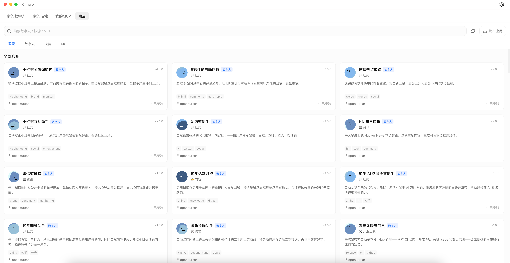

<div align="center">


# Halo AI 工作站

**开源桌面 AI 工作站 · 数字人团队 · 随时随地交办**

[](https://github.com/openkursar/hello-halo/stargazers)
[](../LICENSE)
[](#下载安装)
[](https://github.com/openkursar/hello-halo/releases)

[**下载**](#下载安装) · [**官网与文档**](https://hello-halo.cc/) · [**参与贡献**](#参与贡献)

**[English](../README.md)** | **[繁體中文](./README.zh-TW.md)** | **[Español](./README.es.md)** | **[Deutsch](./README.de.md)** | **[Français](./README.fr.md)** | **[日本語](./README.ja.md)**

</div>

---

Halo 是一款开源的桌面 AI 工作站。日常用法和主流桌面 AI 工作台一样：对话、写代码、做文档、查资料。更进一步，你可以拥有长期在岗的**数字人**，让它们组成团队分工协作；人不在电脑前时，也能通过手机、飞书、微信或企业微信随时交办和跟进。

<p align="center">
  
</p>

## 为什么是 Halo

人人都在用 AI，每个人自己的效率确实上去了；可工作之间的衔接还是靠人：把这个 AI 的结论复制给那个 AI，把文件和结论转给同事，同事再对自己的 AI 重讲一遍。人成了最大的瓶颈：个人提效了，团队的效率却没有跟上来。

Halo 让 AI 之间直接分工、交接、积累记忆、持续值守，人只负责定方向、做决定。个人提效是加法，协作提效是乘法。

- **适合谁**：重度 AI 用户、开发者、研究与运营人员，以及想把 AI 用进日常流程的小团队。
- **三件事**：[日常 AI 工作台](#一日常-ai-工作台) · [数字人与数字人团队](#二数字人与数字人团队) · [随时随地交办](#三随时随地交办)
- **由 Halo 写成**：AI 自我迭代的大型 AI 工作站，超过 50 万行代码，稳定运行在金融企业级环境。

---

## 一、日常 AI 工作台

- **对话 + 画布**：报告、代码、网页、终端、Word / Excel / PDF 都能在对话旁边打开；选中一段内容、加一句批注，AI 就知道你说的是哪里。
- **按需开启能力**：输入框的"＋"里一键打开网页控制、团队协作、AI 终端、文字识别、操作 Halo；本机文件和文件夹直接附加，不用上传。
- **写代码**：可选 Claude Code、Codex、Halo SDK 等引擎；在变更视图里看清 AI 实际改了什么，再一键发起快速审查，或多角色的团队审查。
- **AI 浏览器与终端**：AI 操作真实的浏览器和终端，你在旁边看得见，随时接手或停止。
- **办公文档**：内置文档处理技能和运行环境，直接生成、修改 Word、Excel、PPT、PDF，不用先装一堆依赖。
- **知识库与记忆**：文件、文件夹、PDF、Office 文档导入知识库后，聊天时自动引用并标注出处；同一空间的多个聊天共享记忆，按"当前状态 / 历史 / 专题知识"分层整理，换个聊天不用从头介绍。
- **会话互通、操作 Halo**：新开一个会话问"其他几个会话进行得怎样了？"，它会逐个去看、汇总给你；AI 也能替你管理空间、数字人和设置。
- **接入你的工具**：MCP 服务和技能（Skills）一键连接，兼容 Claude Code 的 MCP 与 Skills 生态。
- **多模型、多账号**：支持任意 Anthropic / OpenAI 兼容的 API，也能同时登录多个 ChatGPT、Claude、GitHub Copilot 账号，按会话切换模型与思考强度。

<p align="center">
  <br>
  <sub>图 1　对话中通过“＋”按需开启网页控制、团队协作、AI 终端等能力</sub>
</p>

<p align="center">
  <br>
  <sub>图 2　AI 自动拆解任务计划，联网检索并逐项推进</sub>
</p>

<p align="center">
  <br>
  <sub>图 3　接入主流工具：企业微信待办、文档等 MCP 服务一键连接</sub>
</p>

---

## 二、数字人与数字人团队

一个 AI 包揽所有事，注意力有限；只认识你的 AI，帮不上整个团队。分工不只适用于人，也适用于 AI。

| | 一个 AI 包揽 | 数字人团队 |
|---|---|---|
| 分工 | 说明和工具挤在一处 | 每个数字人只管一道工序 |
| 出了错 | 不知道哪一步错了 | 哪道工序出错，一眼可查 |
| 交接 | 人来转发，重讲前因后果 | 数字人之间直接提问、交付 |
| 能找谁 | 只认识你 | 还认识同事的数字人 |

- **数字人**：长期在岗的 AI 成员。按计划或事件自动运行（可以只在中国大陆工作日运行，节假日和调休都算在内），也能在聊天里随口交代一个提醒；从商店一键安装，或用一句话创建。
- **一句话组队**：在任意空间对 AI 说"帮我组个团队，调研这三款产品"，研究、核对、写作各有分工；想以后接着用，再说一句"保留这个团队"，还能给整支团队设定运行计划。
- **跨电脑组队**：同事带着自己的数字人加入你的团队，各自在自己的电脑上运行。数据留在各自电脑上，只有发布给团队的成果在团队里流转；每个数字人能做什么，由它的主人决定。同一局域网开启远程访问即可邀请，跨网络在设置里配置中转网关。
- **过程看得见**：团队工作台集中展示任务、进展、队友之间的对接和成果。数字人之间自己对接，团队定不了的事才来问你。

> 试试这样说："帮我研究这几款产品，分开查资料、核对结论，最后整理成一份报告。"

<p align="center">
  <br>
  <sub>图 4　数字人团队：负责人派发任务，成员交付成果、相互验收</sub>
</p>

<p align="center">
  <br>
  <sub>图 5　每日新闻速递数字人：每天 08:00 自动运行，结果推送到企业微信</sub>
</p>

### 商店、Browser Action 与生态

- **数字人商店**：挑一个，填几项配置就开始运行，不用写提示词。企业可以部署私有商店，在设置里添加即可。
- **Browser Action：AI 决策，脚本执行**：把某个平台上的一个具体操作写成可复用的 `.js` 脚本，AI 只决定做什么、什么时候做，脚本负责精确执行。小红书、B 站、知乎、X 等平台已有现成的 Action，内部系统也可以写私有 Action。[动手做一个 →](https://hello-halo.cc/docs/developers/digital-humans/build.html)
- **发布你的数字人**：写一份 `spec.yaml`，向[数字人协议（DHP）](https://github.com/openkursar/digital-human-protocol)提交 PR，合并后所有 Halo 用户都能安装。

<p align="center">
  <br>
  <sub>图 6　数字人商店：社交运营、资讯简报、监控巡检……装上即用</sub>
</p>

---

## 三、随时随地交办

人不在电脑前，工作照样推进。

- **手机与远程网页**：远程访问运行在家里或办公室电脑上的 Halo，交办任务、上传材料、下载成果。
- **IM 接入**：支持飞书、微信、企业微信。在熟悉的聊天窗口里向数字人交办工作，背后可以是一整支团队。
- **在 IM 里做决定**：结果直接送到聊天里；需要你拍板的事，回一句，工作就继续往前走。

<p align="center">
  <br>
  <sub>图 7　手机远程使用：完整能力随身带，一句话让电脑完成任务</sub>
</p>

---

## 典型场景

| 场景 | 怎么做 | 结果 |
|---|---|---|
| 竞品 / 行业调研 | 一句话组队：研究、核对、写作分工 | 在团队工作台看进展，拿到成稿报告 |
| 每日资讯简报 | 数字人按工作日定时整理行业或研发动态 | 每天上班前推送到飞书 / 企业微信 |
| 出门在外交办 | 在手机微信里说"把这份方案改一下" | 回到电脑打开成品，或在手机上直接下载 |
| 写代码 | AI 修改后在变更视图审查，再发起团队审查 | 看清改了什么，放心提交 |
| 办公文档 | 让 AI 生成周报、表格、演示材料 | 直接得到 Word / Excel / PPT 文件 |
| 内部系统巡检 | 数字人定时登录 OA、审批、工单系统巡查 | 逾期和异常推送到 IM，等你处理 |
| 社交平台运营 | 安装商店里现成的 Browser Action 数字人 | 定时回复评论、发布内容、追踪舆情 |

**看演示**：[产品演示](https://www.bilibili.com/video/BV1jEZYBaEcy/) · [数字人 7x24 运营](https://www.bilibili.com/video/BV1yfNuzaEtv/) · [AI 浏览器](https://github.com/user-attachments/assets/2d4d2f3e-d27c-44b0-8f1d-9059c8372003)

---

## 快速开始

1. [下载安装](#下载安装)，打开 Halo。
2. 用 Claude 或 ChatGPT 账号登录，或者填入任意 Anthropic / OpenAI 兼容服务的 API Key。
3. 创建一个空间：一个项目一个空间，文件和记忆互不干扰。
4. 直接对话交办；或者从商店安装数字人、一句话组建团队。
5. 需要时开启远程访问，或绑定飞书 / 微信 / 企业微信，随时随地继续。

## 下载安装

| 平台 | 下载 | 系统要求 |
|---|---|---|
| macOS（Apple 芯片） | [.dmg](https://github.com/openkursar/hello-halo/releases/latest) | macOS 12+ |
| macOS（Intel） | [.dmg](https://github.com/openkursar/hello-halo/releases/latest) | macOS 12+ |
| Windows | [.exe](https://github.com/openkursar/hello-halo/releases/latest) | Windows 10+（x64） |
| Linux | [.AppImage](https://github.com/openkursar/hello-halo/releases/latest) | glibc 2.34+（Ubuntu 22.04+、Debian 12+） |
| Android（远程客户端） | [.apk](https://github.com/openkursar/hello-halo/releases/latest) | Android 7.0+ |
| iOS（远程客户端） | 从源码构建 | iOS 15+ |

下载、安装、运行，不需要 Node.js、npm 或命令行；没有服务端依赖，IT 可以直接分发。之后自动更新：Windows 从 3.0 起，新版本会在后台准备好，点重启即可完成。Linux 版暂不包含 AI 终端。

### 从源码构建

```bash
git clone https://github.com/openkursar/hello-halo.git
cd hello-halo
npm install
npm run prepare
npm run dev
```

---

## 技术特点

- **开源，运行在你自己的电脑上**：文件与工作环境由你掌控；Halo 没有自己的后端服务。
- **可插拔 Agent 引擎**：Claude Code、Codex，以及自研的 Halo SDK（资源占用低、启动更快，针对开源模型优化）、DeepSeek dsh，按需选择。
- **去中心化的分布式数字人团队**：成员分布在不同电脑上协作，没有中心服务器；团队状态借鉴 Raft 共识算法，按多数派选出负责节点、按任期复制日志，负责节点所在的电脑下线后自动重新选举，不会出现两个负责节点，团队照常运转。[设计说明](https://hello-halo.cc/docs/advanced/team-consensus.html)
- **细节**：空间隔离、深浅色主题、50%–150% 界面缩放，界面支持 7 种语言。

---

## 参与贡献

- **翻译**：`src/renderer/i18n/`
- **Bug 报告**：[Issues](https://github.com/openkursar/hello-halo/issues)
- **功能建议**：[Discussions](https://github.com/openkursar/hello-halo/discussions)
- **代码贡献**：欢迎 PR，从源码构建见[上文](#从源码构建)

详见 [CONTRIBUTING.md](../CONTRIBUTING.md)。

## 社区

- [GitHub Discussions](https://github.com/openkursar/hello-halo/discussions)
- [GitHub Issues](https://github.com/openkursar/hello-halo/issues)

<p align="center">
  
</p>
<p align="center">
  <em>任何反馈和交流，欢迎添加微信：go2halo，备注 "Halo"</em>
</p>

---

## Halo 的故事

2025 年 10 月，一个简单的困扰：**我想用 Claude Code，但整天在开会。**

在一个无聊的会议上，我想：*如果能用手机遥控家里电脑上的 Claude Code 呢？*

然后是第二个问题——非技术同事也想用，但卡在了安装上。*"npm 是什么？"*

于是我做了 Halo：可视化界面、一键安装、远程访问。第一个版本花了几个小时。之后的一切？**几乎全部由 Halo 自己构建。** 2026 年初，Halo 开源。

我们相信下一步是 **AI 工作站**：AI 不再需要有人盯着才能干活。你设定目标，数字人 7x24 自主推进，你只在关键节点做决策。3.0 让数字人组成团队、跨电脑协作，离这个目标又近了一步。

—— [@openkursar-flynn](https://github.com/openkursar-flynn)，Halo 发起人

---

## 许可证

MIT — [LICENSE](../LICENSE)

---

<div align="center">

## 贡献者

<a href="https://github.com/openkursar/hello-halo/graphs/contributors">
  
</a>

**Star 这个仓库**，帮助更多人发现 Halo。

</div>

---

## 合作伙伴与赞助商

如果 Halo 启发了你的项目，或者你基于 Halo 构建了新产品，欢迎提到我们。

### 企业合作伙伴

| 你的公司在使用 Halo？ | [告诉我们](https://github.com/openkursar/hello-halo/issues/new?title=Add+our+company+as+partner) — 我们很乐意在此展示。 |
|:---:|:---:|

### 赞助商

<a href="https://www.nnscholar.com/">
  
</a>

<p align="center">
  <a href="https://ifdian.net/a/hello-halo">爱发电（支付宝 / 微信）</a> · <a href="https://buy.polar.sh/polar_cl_x7bTGvMvt3rbUt6oE98z0zb2zFz1sT7dG37BA3foNsZ">Polar（国际信用卡）</a>
</p>

---

<div align="center">

[回到顶部](#halo-ai-工作站)

</div>
