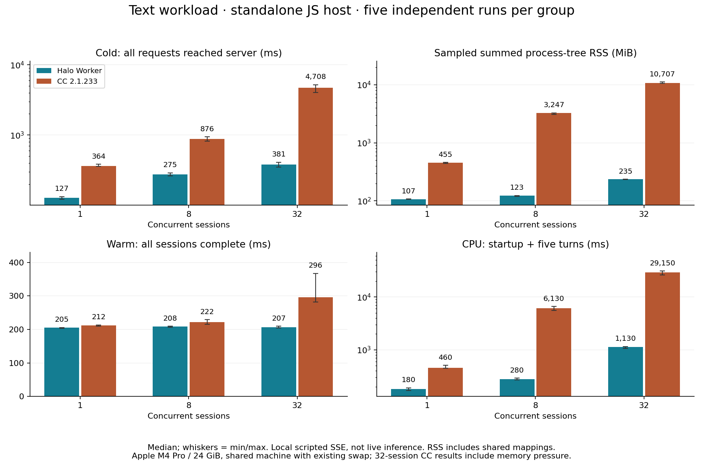
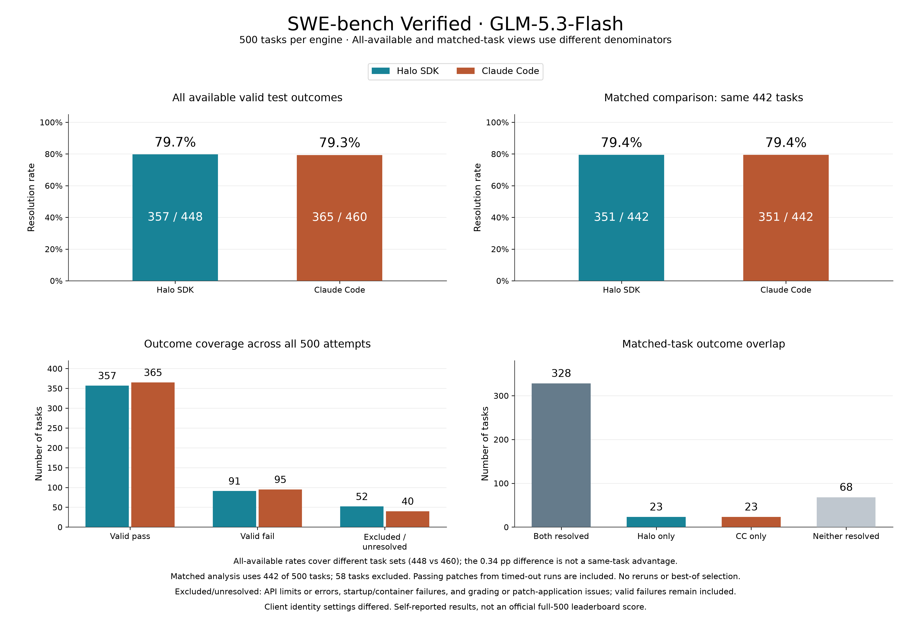
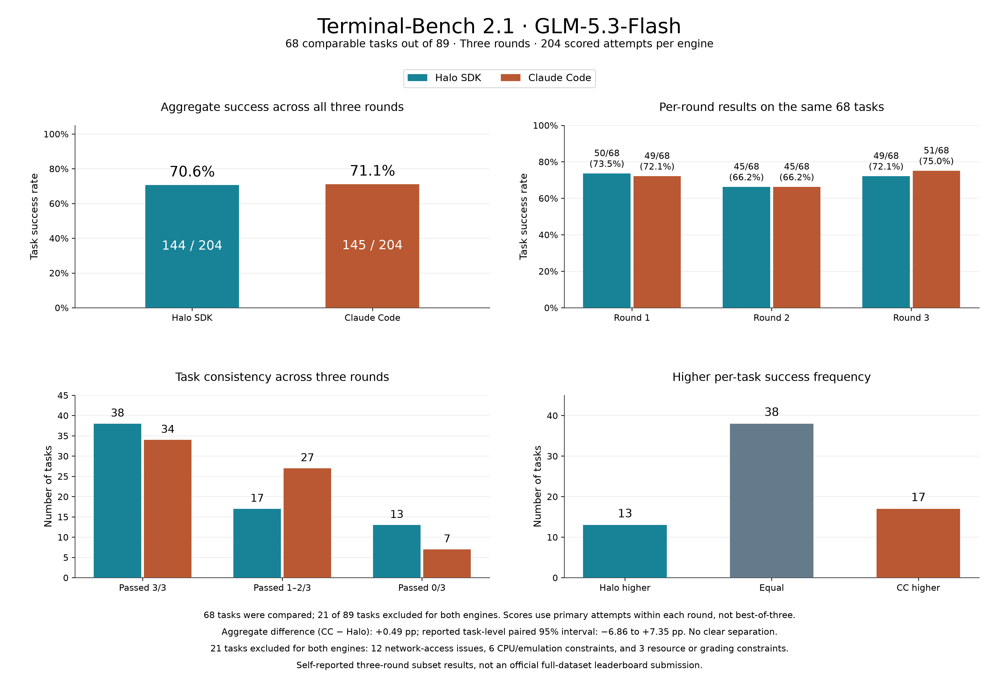

# Halo Agent SDK

English | [简体中文](README.zh-CN.md)

**Familiar agent APIs, flexible model support, and low-overhead concurrent execution.**

Halo Agent SDK is an embeddable agent runtime for servers, desktop applications,
and automation. It provides tool execution, streaming responses, persistent
sessions, context management, and collaborators, with a focus on sustained task
execution and host resource costs.

The JavaScript/TypeScript API loads an in-process Rust core through Node-API.
The core owns the model loop, tools, history and context management; JavaScript
retains host callbacks and public objects. Direct and Worker execution use the
same core and shared native execution resources.

> Rust in `crates/halo-core/src/` is the only execution implementation. Node integration lives in `bindings/node/`; public npm entry points are unchanged.

## Why a lighter agent runtime?

Applications may need dozens or eventually hundreds of independent agent
sessions. When each session starts a complete agent process, runtime loading,
initialization, resident memory, and inter-process communication costs accumulate.
Even when inference runs remotely, the client or server still bears these local
costs.

**Reducing the local cost of concurrent agents is a core design goal.**

The native loop runs outside the host's JavaScript thread. Optional shared Workers
also isolate the JavaScript facade and worker-side callbacks. Sessions keep
separate conversation histories while reusing execution resources. The historical
measurements below cover up to 64 concurrent sessions.

## Core capabilities

| Capability | What it provides |
| --- | --- |
| **Familiar interfaces** | Common Claude Agent SDK tool, message, session, permission-callback, and hook conventions to reduce migration work. |
| **Layered context management** | Lightweight trimming, task handover summaries, and window-pressure fallbacks preserve working state and pointers to earlier records. |
| **Goal recitation and working memory** | Recorded objectives, completion criteria, and todos live outside ordinary message history and return to the model's attention when needed. |
| **Stagnation and unfinished-work checks** | Repeated calls and errors produce factual feedback; configurable turn-end checks address premature completion, particularly for models with less reliable task persistence. |
| **Actionable tool results** | Errors explain recovery options, truncation provides a route to omitted content, and permission refusals preserve the boundary. |
| **Input during execution** | Accept new requirements, corrections, and interruption while a task is running; new input is consumed at subsequent model steps. |
| **Lightweight collaboration** | Independent collaborator sessions, directed messages, parallel assignments, and shared task/artifact records through local collaboration or host-supplied tools. Local collaborators reuse the execution runtime. |
| **Extensible lifecycle** | Tools and hooks let the host supply business rules, approvals, and interaction policy. |

Stagnation detection runs locally without an extra judging model. It reports
observed facts and lets the model decide how to respond. Turn-end checks can add
model requests and are configurable. Stable instructions and changing task state
are organized separately to support prefix reuse where the provider offers it.

## Performance and evaluations

The results below describe the earlier SDK snapshots identified in their reports.
They do not establish performance or task-completion results for the current
Rust core; measurements of a different implementation must be reported separately.

### Runtime overhead

The **2026-11-02** evaluation compared Halo Worker execution with **Claude Code
2.1.233** (abbreviated CC below) on an Apple M4 Pro with 24 GiB RAM and Node.js 22.23.3. All **82 independent
cases** passed their protocol, result, and cleanup assertions. The chart shows
medians of five repetitions of the ordinary text workload.



- **32 concurrent sessions:** Halo reached the first-request boundary in about
  **381 ms**, with **235 MiB** sampled peak process-tree RSS; CC measured
  **4,708 ms** and **10,707 MiB**.
- **64 concurrent sessions:** Halo used **8 Workers**, with about **483 ms**
  preparation time and **380 MiB** sampled peak RSS. CC was not tested at 64 sessions.
- **Warm-session speed depends on workload:** with eight sessions and 128 KiB
  inputs, the warm batch took about **58 ms for CC** and **64 ms for Halo**.

Preparation is measured from JS-host engine loading until every session's first
request reaches the model server. These are real engines using a local scripted
model, not live inference. Summed RSS can count shared pages more than once, and
the machine was under memory and swap pressure. The measurements do not establish
fixed physical-memory savings or real-task speedups on other machines.

[Full report and methodology](docs/benchmarks/runtime.md) ·
[Per-case measurements](docs/benchmarks/runtime-results.json)

### Task completion

Both evaluations use GLM-5.3-Flash and compare Halo SDK with Claude Code.

| Evaluation | Focus | Result |
| --- | --- | --- |
| **SWE-bench Verified** | Software issue resolution, token usage, and cost | **79.4%** on the 442-task matched set (351/442 for both engines) |
| **Terminal-Bench 2.1** | Complex terminal task completion and execution cost | **70.6% vs 71.1%** over three rounds (Halo 144/204, Claude Code 145/204); no clear separation |



The chart compares all available outcomes and the matched 442-task subset. The
all-available rates use different denominators (448 vs 460 tasks), so the
difference there is not a same-task advantage. Valid failures remain included;
excluded or unresolved tasks include API limits or errors, startup or container
failures, and grading or patch-application issues. Passing patches from timed-out
runs are included, with no reruns or best-of selection.



The chart covers 68 of 89 tasks over three rounds, scoring each round's primary
attempt rather than a best-of-three selection. The 21 excluded tasks affected both
engines: 12 network-access issues, 6 CPU or emulation constraints, and 3 resource
or grading constraints. The aggregate difference is +0.49 percentage points
(CC − Halo), with a task-level paired 95% interval of −6.86 to +7.35 points.

These are self-reported results, not official full-dataset leaderboard
submissions. Runtime overhead and task-solving ability are evaluated separately.

## Models and code search

### Model choice

Use Anthropic, OpenAI-compatible endpoints, or a custom Provider. Tool-call format,
prompt profile, context window, and output budget can be configured for the actual
model and endpoint. Native tool calling is the default; explicit XML/JSON adapters
are available for endpoints that need them. Protocol compatibility and task
performance should be evaluated separately.

### Exact search and semantic code discovery

Grep supports keywords, regular expressions, filtering, counts, and pagination.
The optional CodeSearch tool finds likely code locations from natural-language
questions when the file or symbol name is unknown. Read and Grep verify the
current source behind those candidates.

Matching workspaces and backend configurations share a search instance within the
same host process. This **experimental, opt-in** local backend starts on demand
and releases idle processes. Its model and index have additional resource costs;
the runtime benchmark above did not enable it.

## Quick start

Requires Node.js 20 or later. Building from source also requires a rustup-managed
Rust 1.90.0 toolchain and a C compiler/linker for the target platform. The toolchain
is pinned in `rust-toolchain.toml`. Run these commands from the SDK directory
(`src/sdk/halo-sdk` in the Halo repository):

```sh
rustup toolchain install 1.90.0 --profile minimal
npm ci
npm run build
```

The build generates the JavaScript facade, Worker bundle and native library for
the current OS and CPU. A built distribution needs the matching `.node` library
and `dist/native/build-info.json`; consumers do not need Rust when those artifacts
are already included. Loading errors are explicit, with no fallback
runtime. See [native runtime and build requirements](docs/guide.md#native-runtime-and-build).

Set `MODEL_ID`, `MODEL_BASE_URL`, and `MODEL_API_KEY` for your OpenAI-compatible
endpoint. Save the following as `example.mjs` in the checkout and run
`node example.mjs`:

```js
import { query, createProvider } from '@hello-halo/agent-sdk';

const {
  MODEL_ID: model,
  MODEL_BASE_URL: baseUrl,
  MODEL_API_KEY: apiKey,
} = process.env;

if (!model || !baseUrl || !apiKey) {
  throw new Error('Set MODEL_ID, MODEL_BASE_URL and MODEL_API_KEY.');
}

const provider = createProvider({
  type: 'openai-compat',
  baseUrl,
  apiKey,
  defaultModel: model,
});

for await (const event of query({
  prompt: 'Inspect this repository and explain its structure.',
  options: {
    model,
    provider,
    cwd: process.cwd(),
    tools: ['Read', 'Glob', 'Grep'],
  },
})) {
  if (event.type === 'result') console.log(event);
}
```

Use persistent sessions for multi-turn work and the Worker entry for shared
execution. The [integration guide](docs/guide.md) has full examples and lifecycle
requirements.

## Migrating from Claude Agent SDK

Public interface names, option fields and message shapes are compatible with
`@anthropic-ai/claude-agent-sdk`, so existing integrations can switch over.

Within the supported compatibility surface, Halo can replace an existing Claude
Agent SDK integration while reusing application calls, event handling, and tool
integration. Migration mainly changes the SDK dependency, imports, and model
initialization. For example, the supported `query` entry changes from:

```js
import { query } from '@anthropic-ai/claude-agent-sdk';
```

to:

```js
import { query } from '@hello-halo/agent-sdk';
```

The supported compatibility surface:

- `query` and `createSession` entry points.
- Message shapes, tool and hook conventions, permission callbacks.
- Persistent sessions and automatic compaction.

Not supported:

- The built-in sub-agent tool and `Options.agents` definitions; delegation uses
  collaboration `spawn_agent` and `team_send`.
- CLI-specific settings, `query().streamInput()` and manual `/compact`.
- Agent definition and catalog APIs.

See the [API limits](docs/guide.md#api-limits) for details.

Direct execution avoids a separate agent process. Workers still exchange
messages, and Bash, MCP, or optional backends may use subprocesses. Workers are
not an operating-system security sandbox; the host owns identity, permissions,
and deployment policy.

## Optional collaborator model selection

Local collaborators inherit their direct parent's effective model and reasoning
settings. Applications may additionally register `collaboration.modelSelection`
with a captured `policy` (`inherit` or `task`), `policyRevision`, non-secret
`parentBinding`, an asynchronous `getCatalog`, and a cancellable `prepare` callback.
Without this registration, the existing collaboration tools and guidance remain
unchanged.

The host supplies its authorized profile catalog and exact provider bindings.
`spawn_agent` then accepts opaque `model_profile` references from the bounded
`list_model_profiles` directory and an optional `reasoning_effort`. Profiles do
not change tools, permissions, workspaces, budgets or execution engines. Provider
credentials stay in execution-owned bindings, not profile results or member
snapshots. A restored collaborator is prepared from its saved binding identity;
renaming or removing a profile does not silently select another account.

The engine-independent `/collaboration` entry exposes shared planning,
finalization, restoration validation and `ModelProfileCatalogView`. Hosts retain
one view per authorized catalog revision and close it when replaced, so ordinary
selection does not repeatedly copy or validate the entire directory. The
`/collaboration/protocol` entry exports browser-safe types and resource limits,
without importing an execution runtime. See the
[collaboration contract](bindings/node/collaboration/DESIGN.md#optional-model-selection)
for the public interfaces and responsibility boundaries. Worker hosts transport
standard provider configurations; custom providers are constructed in Worker
setup rather than transferred across the Worker boundary.

A local host can bind its own application model service without exposing that
service to model tools:

```ts
import type { LocalModelSelectionHost } from '@hello-halo/agent-sdk/collaboration/sdk';

const modelSelection: LocalModelSelectionHost = {
  policy: 'inherit',
  policyRevision: applicationModels.policyRevision,
  parentBinding: applicationModels.parentBinding,
  getCatalog({ knownRevision, signal }) {
    signal.throwIfAborted();
    const catalog = applicationModels.authorizedCatalog;
    return knownRevision === catalog.revision
      ? { kind: 'unchanged', revision: catalog.revision }
      : { kind: 'snapshot', catalog };
  },
  async prepare(request, { signal }) {
    const binding = request.kind === 'restore'
      ? await applicationModels.restoreExact(request.snapshot, signal)
      : await applicationModels.prepareExact(request.plan, signal);
    return {
      ...binding.metadata,
      providerConfig: { type: 'openai-compat', apiKey: binding.apiKey, baseUrl: binding.baseUrl },
    };
  },
};

const session = await runtime.createSession({
  model: applicationModels.parentModel,
  providerConfig: applicationModels.parentProviderConfig,
  collaboration: { mode: 'local', modelSelection },
});
```

`applicationModels` is application-owned code: it must recheck authorization,
resolve the exact logical binding on restore, and honor cancellation. A catalog
revision must change whenever its authorized contents or policy changes. Standard
prepared connections require an explicit provider `type`; custom providers stay
in their execution environment. The SDK releases its callback leases and streams,
but custom providers must manage external resources through their own lifecycle.
`prepare` returns only target metadata, optional target pricing, and exactly one
provider connection (`providerConfig` or `provider`), not `Options` or a partial
session configuration. It cannot change tools, permissions, hooks, storage,
workspaces, system prompts, or the shared execution budget.

Usage is aggregated through the existing collaboration accounting. Supply the
target's `modelPricing` when an estimate is needed; never apply the parent's price
to a different child's tokens. Missing usage or pricing is unknown, not proof of
zero consumption or a precise provider bill. Per-model totals are not an
account-level billing ledger.

These are routing and lifecycle contracts, not a claim that automated model
selection improves task quality or reduces billed costs. Those outcomes require
comparable real-model evaluation.

## Design influences

Halo adopts Claude Code's publicly documented tool and session interface
protocol, along with ideas from the open-source Codex harness around execution
and context management.

We develop and optimize these ideas for **open-source models**, long-running
tasks, and multi-session applications: keep the model/tool loop clear, support
model judgment with reliable state and execution feedback, extend behavior
through lifecycle hooks, and validate changes with reproducible evaluations.

## Documentation

- [Integration and configuration guide](docs/guide.md)
- [Runtime architecture and binding boundary](DESIGN.md)
- [Core execution contract](crates/halo-core/src/core/DESIGN.md)
- [Worker runtime](bindings/node/worker/DESIGN.md)
- [Skills and progressive disclosure](crates/halo-core/src/skills/DESIGN.md)
- [Resource and lifecycle validation](validation/README.md)
- [Behavioral validation](validation/BEHAVIOR.md)
- [SWE-bench evaluation harness](swe-bench-eval/README.md)
- [Semantic search measurements and limits](bindings/node/search/VALIDATION.md)

## License

[MIT](LICENSE). Third-party license and copyright notices ship in
`dist/worker/THIRD-PARTY-NOTICES.txt` and `dist/native/THIRD-PARTY-NOTICES.txt`.
