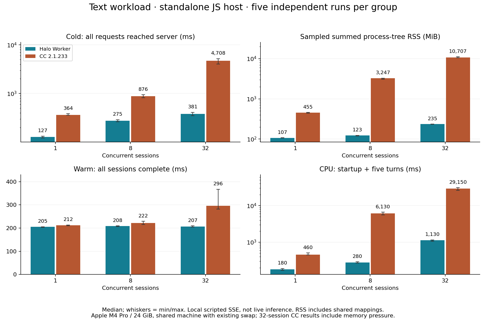
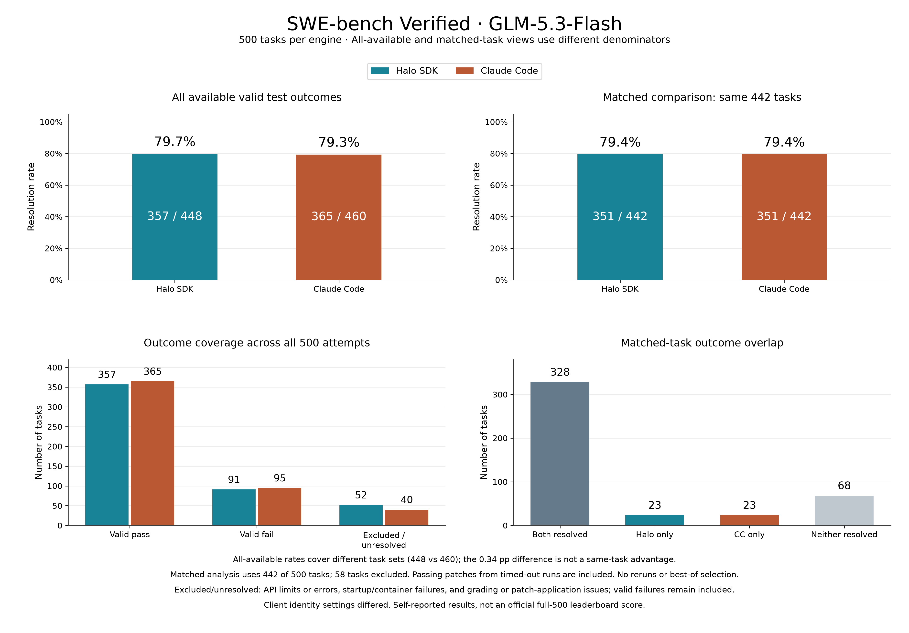
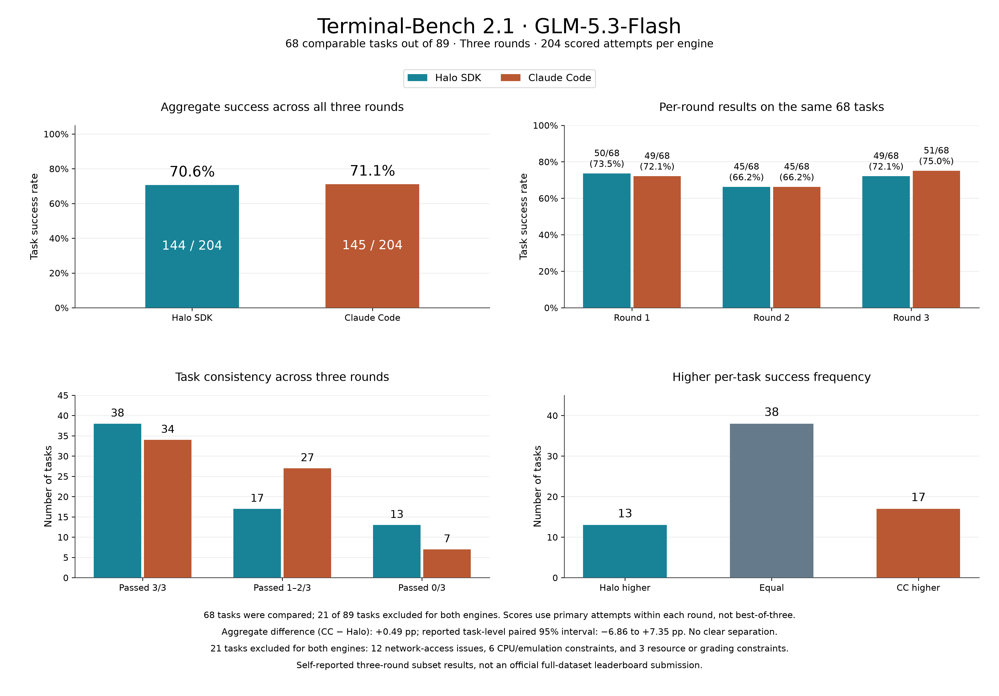

# Halo Agent SDK

[English](README.md) | 简体中文

**兼容熟悉的 Agent 接口，为多模型、长任务和低开销并发而设计。**

Halo Agent SDK 是一个可嵌入服务端、桌面应用和自动化系统的 Agent 运行时。它提供工具执行、流式响应、持久会话、上下文管理和团队协作，并围绕模型持续执行能力与宿主资源成本进行优化。

## 为什么需要更轻的 Agent 运行时

应用对 Agent 的需求，可能从单个助手扩展到数十乃至数百个独立会话。

如果每个会话都启动完整的 Agent 进程，运行时加载、会话初始化、常驻内存和进程通信的成本就会随会话数量叠加。即使模型在远端推理，客户端或服务器仍然需要承担这些本地开销。

**降低多 Agent 的本地资源成本，是 Halo Agent SDK 的核心设计目标。**

Agent 循环可以直接在进程内运行，也可以通过共享 Worker 承载多个会话。各会话维护独立历史，执行环境则尽可能复用，减少重复启动与加载，并让 Agent 执行离开宿主的 JavaScript 主线程。当前公开性能验证覆盖至 64 个并发会话。

## 核心能力

| 能力 | 设计重点 |
| --- | --- |
| **熟悉的接口** | 兼容常用的 Claude Agent SDK 工具、消息、会话、权限回调与 Hooks 约定，降低迁移成本。 |
| **分层上下文管理** | 轻量裁剪、交接摘要与窗口兜底相结合，保留工作状态和历史回查线索。 |
| **目标复诵与工作记忆** | 已记录的目标、完成标准和待办保存在普通消息历史之外，在需要时重新带回模型视野。 |
| **停滞与提前退出检查** | 根据重复调用和错误提供事实反馈；可配置的收尾检查尤其面向持续执行不够稳定、容易提前结束任务的模型。 |
| **有方向的工具反馈** | 报错说明修正方向，截断提供恢复路径，权限拒绝保留操作边界。 |
| **运行中交互** | 执行期间接受补充要求、方向纠正和停止操作，新输入在后续模型步骤中被消费。 |
| **轻量协作** | 通过本地协作或宿主提供的工具，支持独立协作者会话、定向消息、并行任务与共享任务／产物记录；本地协作者复用执行运行时。 |
| **可扩展的生命周期** | 通过工具和 Hooks 接入业务规则、审批与交互策略。 |

停滞检测由本地代码完成，无需额外调用评审模型。它反馈已经观察到的事实，由模型判断如何继续。收尾检查可能增加模型请求，可以配置。稳定指引与动态任务状态分开组织，以便在服务商支持时复用请求前缀。

## 性能与评测

### 运行时开销

**2026-11-02**，在 Apple M4 Pro、24 GiB 内存、Node.js 22.23.3 环境下，对照 **Claude Code 2.1.233**（下文简称 CC），完成了 **82 个独立用例**，均通过协议、结果和资源清理检查。下图为普通文本负载五次重复的中位数。



- **32 个并发会话**：Halo 启动准备约 **381 ms**，采样峰值进程树 RSS 约 **235 MiB**；CC 分别约 **4,708 ms**、**10,707 MiB**。
- **64 个并发会话**：Halo 使用 **8 个 Worker**，启动准备约 **483 ms**，采样峰值 RSS 约 **380 MiB**。CC 的 64 会话对照未运行。
- **热会话表现取决于负载**：在 8 会话、128 KiB 输入的测试中，CC 热轮约 **58 ms**，Halo 约 **64 ms**。

启动准备从 JS 宿主开始加载引擎计时，直到全部会话的首个请求抵达模型服务器。测试使用真实引擎和本地模拟模型，不执行真实推理。RSS 合计可能重复计算共享页，测试机器也存在内存与换页压力；这些数据不代表其他机器上的固定物理内存节省比例或真实任务加速倍数。

[完整报告与测试方法](docs/benchmarks/runtime.zh-CN.md) · [逐用例指标](docs/benchmarks/runtime-results.json)

### 任务完成能力

两项评测均使用 GLM-5.3-Flash，对比 Halo SDK 与 Claude Code。

| 评测 | 关注内容 | 结果 |
| --- | --- | --- |
| **SWE-bench Verified** | 真实软件问题修复成功率、token 消耗与费用 | 匹配的 442 个任务上均为 **79.4%**（双方各 351/442） |
| **Terminal-Bench 2.1** | 复杂终端任务完成率与执行成本 | 三轮合计 **70.6% 对 71.1%**（Halo 144/204，Claude Code 145/204）；未见明确差异 |



图中同时给出全部有效结果和 442 个任务的匹配子集。全部结果的样本集不同
（448 与 460 个任务），因此这一差异不代表同一批任务上的优势。有效失败仍计入
结果；排除或未解决的情况包括 API 限制或错误、启动或容器失败，以及评分或补丁
应用问题。超时运行中通过测试的补丁计入结果，不重跑，也不择优。



图中覆盖 89 个任务中的 68 个，共三轮；每轮只计入主尝试，不取三轮最优。双方
共同排除的 21 个任务包括 12 个网络访问问题、6 个 CPU 或模拟环境限制，以及
3 个资源或评分限制。三轮合计差异为 +0.49 个百分点（Claude Code − Halo），
任务级配对 95% 区间为 −6.86 至 +7.35 个百分点。

以上为自测结果，并非官方全量榜单提交。运行时开销与任务完成能力分别评估。

## 多模型与代码检索

### 灵活选择模型

支持 Anthropic、OpenAI-compatible 端点和自定义 Provider，并可根据实际模型与端点配置工具调用方式、提示词风格、上下文窗口和输出预算。原生工具调用是默认方式；XML／JSON 工具调用适配可用于需要它们的端点。协议兼容与任务完成质量分别验证。

### 精确搜索与语义定位

Grep 提供关键词、正则、过滤、计数和分页搜索。可选的 CodeSearch 使用自然语言寻找相关代码位置，适合不知道文件名或符号名的情况，再通过 Read 和 Grep 核实候选位置的当前代码。

同一宿主进程中，匹配工作区和配置的检索实例可以共享。这项本地检索能力目前为**实验性、显式启用**，按需启动并在空闲后回收。模型与索引有额外资源成本，上述基础运行时测试未启用该后端。

## 快速开始

需要 Node.js 20 或更新版本。从源码安装并构建：

```sh
npm ci
npm run build
```

为你的 OpenAI-compatible 端点设置 `MODEL_ID`、`MODEL_BASE_URL` 和 `MODEL_API_KEY`。将下面的代码保存为源码目录中的 `example.mjs`，执行 `node example.mjs`：

```js
import { query, createProvider } from '@hello-halo/agent-sdk';

const {
  MODEL_ID: model,
  MODEL_BASE_URL: baseUrl,
  MODEL_API_KEY: apiKey,
} = process.env;

if (!model || !baseUrl || !apiKey) {
  throw new Error('Set MODEL_ID, MODEL_BASE_URL and MODEL_API_KEY.');
}

const provider = createProvider({
  type: 'openai-compat',
  baseUrl,
  apiKey,
  defaultModel: model,
});

for await (const event of query({
  prompt: 'Inspect this repository and explain its structure.',
  options: {
    model,
    provider,
    cwd: process.cwd(),
    tools: ['Read', 'Glob', 'Grep'],
  },
})) {
  if (event.type === 'result') console.log(event);
}
```

多轮任务使用持久会话；共享执行使用 Worker 入口。完整示例、配置和关闭要求见[接入指南](docs/guide.md)。

## 从 Claude Agent SDK 迁移

公开的接口名称、选项字段和消息结构与 `@anthropic-ai/claude-agent-sdk` 保持兼容，便于现有集成直接切换。

在已支持的兼容范围内，可以用 Halo 替换原有 Claude Agent SDK 接入，复用业务调用、事件处理和工具集成。迁移主要涉及 SDK 依赖、导入路径和模型初始化配置。

例如，已支持的 `query` 接口从：

```js
import { query } from '@anthropic-ai/claude-agent-sdk';
```

调整为：

```js
import { query } from '@hello-halo/agent-sdk';
```

支持的兼容范围：

- `query` 与 `createSession` 入口。
- 消息结构、工具与 Hooks 约定、权限回调。
- 持久会话和自动压缩。

不兼容：

- 内置子 Agent 工具和 `Options.agents` 定义；任务委派使用协作工具 `spawn_agent` 和 `team_send`。
- CLI 专属设置、`query().streamInput()` 和手动 `/compact`。
- Agent 定义和目录接口。

详细限制见[接口限制](docs/guide.md#api-limits)。

进程内执行省去独立 Agent 进程；Worker 仍有线程间通信，Bash、MCP 和可选后端也可能使用子进程。Worker 不等同于操作系统安全沙箱，宿主负责用户身份、权限和部署策略。

## 设计思路

Halo 吸收了 Claude Code 公开的工具与会话接口协议，以及开源 Codex harness 在执行管理和上下文组织方面的思路。

我们围绕**开源模型**、长期任务和多会话应用的需求进行实现与优化：保持清晰的模型与工具循环，用可靠状态和执行反馈支持模型判断，通过生命周期扩展接入产品规则，并以可复现评测验证效果。

## 文档

- [接入与配置指南](docs/guide.md)
- [核心执行约定](core/DESIGN.md)
- [Worker 运行时](worker/DESIGN.md)
- [技能与渐进加载](skills/DESIGN.md)
- [资源与生命周期验证](validation/README.md)
- [行为验证](validation/BEHAVIOR.md)
- [SWE-bench 评测工具](swe-bench-eval/README.md)
- [语义检索测量与限制](search/VALIDATION.md)

## 许可证

[MIT](LICENSE)。编译后的 Worker 随包提供第三方依赖的许可与版权通知，位于 `dist/worker/THIRD-PARTY-NOTICES.txt`。
