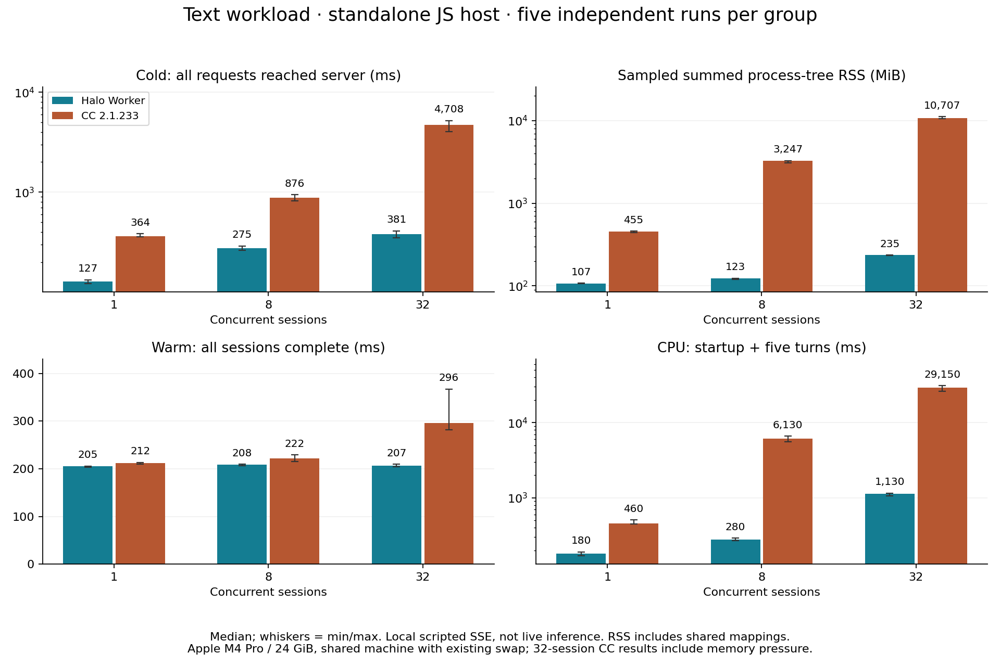

# Runtime overhead benchmark

English | [简体中文](runtime.zh-CN.md) | [SDK overview](../../README.md)

These historical measurements apply to the source and artifacts identified below,
not to the SDK's current Rust implementation. A new runtime needs its own measured
comparison; the figures here remain unchanged.

Measured on **2026-11-02 (Asia/Shanghai)**. The tested Halo Worker implementation
had lower cold preparation time and multi-session resource costs than Claude Code
2.1.233 on this machine. Warm-session performance varied by workload.

The evaluation completed **82 independent cases, 7,875 session turns, and 11,875
model-protocol requests**. Every case passed result, protocol, and cleanup checks.
This is an engine-overhead benchmark with a local scripted model, not a coding
accuracy or live-inference benchmark. Codex was not a comparison arm.

The published [measurements](runtime-results.json) contain group distributions,
all 82 per-case metric records, workload settings, system-load/swap observations,
and artifact hashes. The [runner](harness/engine-benchmark.mjs) and
[native CPU collector](harness/darwin-process-cpu.c) are byte-identical to the
measured versions. Re-running them against a newer SDK snapshot or executable
produces a new experiment, not a reproduction of the original binaries.

## Cold preparation and resident mappings

Ordinary text workload, five independent repetitions per group; table entries
are medians. Preparation starts when the JS host begins loading the engine and
ends when the server receives every session's first request. Node interpreter
startup and model response waiting are outside this boundary.

| Sessions | Halo preparation ms | CC preparation ms | Halo peak RSS MiB | CC peak RSS MiB | Halo Workers / CC engine processes |
| --- | --- | --- | --- | --- | --- |
| 1 | 127 | 364 | 107 | 455 | 1 / 1 |
| 8 | 275 | 876 | 123 | 3,247 | 1 / 8 |
| 32 | 381 | 4,708 | 235 | 10,707 | 4 / 32 |



Observed preparation-time ranges, rather than selected best runs:

| Sessions | Halo min–max ms | CC min–max ms |
| --- | --- | --- |
| 1 | 121–133 | 360–384 |
| 8 | 262–290 | 822–940 |
| 32 | 351–409 | 4030–5209 |

RSS is the sampled sum of resident mappings across the host and observed children.
Worker memory is inside host RSS. Shared pages may be counted in multiple CC
processes, so these are not deduplicated physical-RAM measurements.

## Warm concurrent work

Values are **Halo Worker / CC**, medians across independent repetitions. Each
session completes one initial turn and then reuses the same session. Ordinary
responses wait 100 ms and stream approximately 2 KiB in 128-character chunks with
5 ms intervals. A tools turn performs Read, Write, and a final response: three
model requests.

| Workload | Sessions | Request arrival ms | Batch completion ms | Turns/second | Work CPU ms |
| --- | --- | --- | --- | --- | --- |
| Text | 1 | 1.3 / 3.4 | 205 / 212 | 4.9 / 4.7 | 180 / 460 |
| Text | 8 | 4.2 / 4.3 | 208 / 222 | 38.6 / 36.1 | 280 / 6,130 |
| Text | 32 | 5.6 / 24.8 | 207 / 296 | 155.6 / 104.8 | 1,130 / 29,150 |
| Actual Read + Write | 8 | 3.9 / 4.4 | 422 / 438 | 18.9 / 18.2 | 420 / 7,040 |
| Actual Read + Write | 32 | 5.5 / 30.8 | 421 / 545 | 76.0 / 54.2 | 1,770 / 34,900 |

CPU covers loading, session creation, and all five turns in the case; it is not a
per-turn duration or percentage. Both engines use cumulative system-reported
user+system time with 10 ms per-process display resolution. Short-lived helpers
can exit between samples, making work CPU a sampled lower bound. Three-second
idle observations are too short to establish zero long-term CPU usage.

Tool cases read a fresh random seed each turn, verify the returned contents and
actual written file, and check every session/turn marker. Missing results, tool
errors, unexpected requests/retries, abnormal exits, or observed surviving
processes fail the case rather than contributing successful throughput.

## Larger input, shorter simulated responses

Each input adds 128 KiB; five turns accumulate in the same session. Response and
chunk delays are both 1 ms. Each group has three repetitions. This stresses
assembly, serialization, and stream processing rather than real inference.

| Sessions | Preparation ms | Warm request ms | Warm batch ms | Peak RSS MiB |
| --- | --- | --- | --- | --- |
| 8 | 287 / 833 | 26.2 / 14.4 | 64 / 58 | 171 / 3,345 |
| 32 | 395 / 4,418 | 46.2 / 93.7 | 114 / 282 | 420 / 11,141 |

**Counterexample:** at eight sessions, CC's warm-batch median was 58.3 ms and Halo
Worker's was 64.4 ms. Halo was not faster in every workload. Three repetitions do
not precisely characterize small differences in production tail latency.

## 64 sessions and direct execution

Five Halo Worker cases at 64 sessions produced medians of **483 ms** preparation,
**380 MiB** peak RSS, and **211 ms** warm-batch completion, using **8 Workers**.
CC was not run at 64 sessions. The 24 GiB machine already had other applications
and swap usage; swap grew by about 2 GiB during the first 32-session CC case.

A five-run direct-entry comparison at 32 sessions measured **796 ms** preparation
versus **381 ms** for Workers, with warm-batch medians of **213 / 207 ms**. Avoiding
one communication boundary did not guarantee faster concurrent preparation. The
measurements compare whole implementations and do not isolate IPC as the cause
of every difference.

## Workload and measurement controls

- Apple M4 Pro, 12 cores, 24 GiB RAM; macOS ARM64, Darwin 24.1.0; Node 22.23.3.
- Claude Code 2.1.233; Halo SDK 1.0.0 at the source snapshot identified below.
- Fresh host, sessions, working directories, and configuration per case. OS file
  caches are not purged: this is process-cold, not machine-cold measurement.
- Runs are sequential; engine order alternates and concurrency order reverses.
  Text/tools/64-session groups use five repetitions; large-input groups use three.
- Same model identifier, custom system prompt, disabled thinking, enabled partial
  streaming, and default transcript persistence. Ordinary input adds 8,192 filler
  characters; large input adds 131,072. The peer reports synthetic token usage.
- No real provider, user profile, external MCP, semantic backend, collaborator workload,
  automatic compaction workload, or full application UI is measured.
- The text workload exposes no tools; tools cases expose actual Read and Write.
  Engine-generated prompt/tool metadata may still differ.
- The peer, sampler, and supervisor are excluded from engine resource totals but
  still share the machine's CPU and scheduling resources.
- RSS is polled every 100 ms with synchronized boundary samples; short peaks and
  short-lived processes may be missed. CPU uses the same `ps` accounting for both
  arms; the native collector separately validates its idle/busy positive control.
- Each case has an external 120-second deadline and a 14 GiB summed-RSS budget.
  These bound the test; they are not product capacity guarantees.
- Aggregates report median, interpolated p95, min, and max. With three to five
  repetitions here, ranges and individual cases matter more than a precise p95.

| Metric | Measurement boundary |
| --- | --- |
| Sessions ready | Host starts loading the engine until all sessions are initialized |
| Cold request all | Host starts loading the engine until all first requests reach the peer |
| Cold batch | Host starts loading the engine until all first-turn terminal results arrive |
| Warm request | Per-session send until that turn's first request reaches the peer |
| Warm batch | Batch dispatch until every session returns a terminal result |
| Warm throughput | Completed warm turns divided by summed warm-batch durations |
| Peak / resident tree RSS | Sampled maximum / post-idle sum of host and descendant RSS |
| Work tree CPU | Observed cumulative CPU through work completion, minus pre-engine host baseline |
| Idle CPU | Idle CPU delta divided by elapsed time; 100% represents one busy core |
| Host event-loop delay | Host histogram from engine loading through completed turns |

The machine's resource competition and swap pressure are part of these
observations. The report does not establish a fixed cross-machine speedup,
physical-memory ratio, long-duration leak-free behavior, or better task accuracy.

## Reproduction

Requires macOS, Node 20+, Clang, Git, SDK dependencies, and a separately installed
Claude Code executable. Use version 2.1.233 for the closest comparison. The runner
uses local fixtures and a loopback model peer; it does not consume model credits.

From the SDK source checkout, stage the unmodified runner in its expected workspace
layout. Outputs and the isolated SDK build stay in a new temporary directory:

```sh
npm ci
HALO_BENCH_ROOT="$(mktemp -d)"
HALO_BENCH_CC="$(command -v claude)"
mkdir -p "$HALO_BENCH_ROOT/tests/perf/lib" "$HALO_BENCH_ROOT/src/sdk"
cp docs/benchmarks/harness/engine-benchmark.mjs "$HALO_BENCH_ROOT/tests/perf/"
cp docs/benchmarks/harness/darwin-process-cpu.c "$HALO_BENCH_ROOT/tests/perf/lib/"
ln -s "$PWD" "$HALO_BENCH_ROOT/src/sdk/halo-sdk"

node "$HALO_BENCH_ROOT/tests/perf/engine-benchmark.mjs" \
  --cc "$HALO_BENCH_CC" --rounds 5 --concurrency 1,8,32 \
  --engines halo-worker,cc,halo-direct --idle-ms 3000 \
  --output "$HALO_BENCH_ROOT/text"

node "$HALO_BENCH_ROOT/tests/perf/engine-benchmark.mjs" \
  --cc "$HALO_BENCH_CC" --rounds 5 --concurrency 8,32 \
  --engines halo-worker,cc --workload tools --idle-ms 3000 \
  --snapshot "$HALO_BENCH_ROOT/text/manifest.json" \
  --output "$HALO_BENCH_ROOT/tools"

node "$HALO_BENCH_ROOT/tests/perf/engine-benchmark.mjs" \
  --cc "$HALO_BENCH_CC" --rounds 3 --concurrency 8,32 \
  --engines halo-worker,cc --input-chars 131072 \
  --response-delay-ms 1 --chunk-delay-ms 1 --idle-ms 3000 \
  --snapshot "$HALO_BENCH_ROOT/text/manifest.json" \
  --output "$HALO_BENCH_ROOT/large"

node "$HALO_BENCH_ROOT/tests/perf/engine-benchmark.mjs" \
  --cc "$HALO_BENCH_CC" --rounds 5 --concurrency 64 \
  --engines halo-worker --idle-ms 3000 \
  --snapshot "$HALO_BENCH_ROOT/text/manifest.json" \
  --output "$HALO_BENCH_ROOT/64"
```

The first command captures the current SDK source and builds it separately; later
profiles reuse that snapshot. Each case writes metrics and raw local evidence,
and `summary.json` records aggregates. The public JSON contains the selected
per-case measurements rather than conversation transcripts or machine-specific
output paths. A failed case stops the run. The output directory must not already
contain a manifest, so earlier evidence is not overwritten.

The SDK has evolved since the measured snapshot. Compare the source and executable
hashes below when interpreting reruns; the copied harness alone cannot recreate
a different historical source tree.

## Artifact identity

| Artifact | SHA-256 |
| --- | --- |
| SDK source snapshot | `4d4a548d0e19b3d76efd84a1d49092a3a603181226d8f40b153b50dfeb8b57ff` |
| Worker build | `4532219e0431b3c7c5072970d61ea514de905c07362dda44d586eb314adf56be` |
| Claude Code executable | `bc466b6cde63edafc773f471a1fb98787fabb31f52240c8616ce7e1f587b212d` |
| Benchmark runner | `deaf9bf7d3236799c3b65a2b62988c16cf34770c1473e410db64935c102508a6` |
| Native CPU collector | `7367bcbb2d16238feacd42e4d5f109599d2e943adee9b77b62c60f9679cfa117` |
