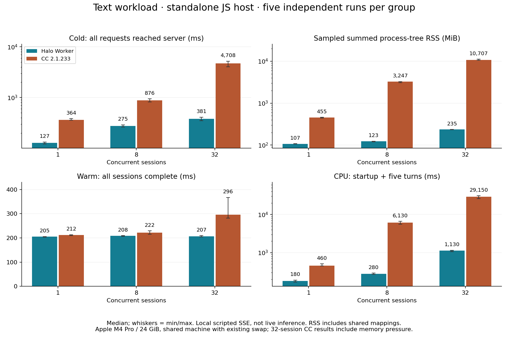

# 运行时开销评测

[English](runtime.md) | 简体中文 | [SDK 概览](../../README.zh-CN.md)

这些历史测量仅对应下文标明的源码和产物，不代表 SDK 当前 Rust 实现的成绩。新的运行时需要单独实测对照；此处原始数据保持不变。

测量日期：**2026-11-02（Asia/Shanghai）**。本机实测中，Halo Worker 的冷启动准备与多会话资源成本低于 Claude Code 2.1.233；热会话表现随负载变化。

正式测量完成 **82 个独立用例、7,875 个会话轮次、11,875 个模型协议请求**，均通过结果、协议和资源清理检查。测试使用本地模拟模型，衡量引擎开销，不衡量编码正确率或真实推理速度，也没有 Codex 对照组。

公开的[测量数据](runtime-results.json)包含分组统计、全部 82 个用例的指标、负载配置、机器负载与换页观察，以及构建指纹。[测试脚本](harness/engine-benchmark.mjs)和[原生 CPU 采样器](harness/darwin-process-cpu.c)与实测版本逐字节一致。用它们运行更新的 SDK 或执行文件会产生新的实验，不能视为原始二进制的精确复现。

## 冷启动准备与驻留映射

普通文本负载，每组独立重复五次，表中为中位数。准备时间从 JS 宿主开始加载引擎计时，到服务器收到全部会话的首个请求为止，不包含 Node 解释器启动或模型响应等待。

| 并发会话 | Halo 准备 ms | CC 准备 ms | Halo 峰值 RSS MiB | CC 峰值 RSS MiB | Halo Worker / CC 引擎进程 |
| --- | --- | --- | --- | --- | --- |
| 1 | 127 | 364 | 107 | 455 | 1 / 1 |
| 8 | 275 | 876 | 123 | 3,247 | 1 / 8 |
| 32 | 381 | 4,708 | 235 | 10,707 | 4 / 32 |



以下是准备时间的实际最小值与最大值，不是挑选的单次最好成绩：

| 并发会话 | Halo 最小–最大 ms | CC 最小–最大 ms |
| --- | --- | --- |
| 1 | 121–133 | 360–384 |
| 8 | 262–290 | 822–940 |
| 32 | 351–409 | 4030–5209 |

RSS 是宿主及观测到的子进程驻留映射之和，Worker 内存包含在宿主 RSS 中。共享页可能在多个 CC 进程中重复计算，因此这不是去重后的物理 RAM 测量。

## 驻留后的并发工作

每格为 **Halo Worker / CC**，取独立重复之间的中位数。每个会话先完成首轮，再复用同一会话继续工作。普通响应固定等待 100 ms，然后以 128 字符分块、5 ms 间隔输出约 2 KiB。工具轮包含 Read、Write 和最终回复，共三次模型请求。

| 负载 | 并发会话 | 请求抵达 ms | 整批完成 ms | 会话轮次/秒 | 工作 CPU ms |
| --- | --- | --- | --- | --- | --- |
| 普通文本 | 1 | 1.3 / 3.4 | 205 / 212 | 4.9 / 4.7 | 180 / 460 |
| 普通文本 | 8 | 4.2 / 4.3 | 208 / 222 | 38.6 / 36.1 | 280 / 6,130 |
| 普通文本 | 32 | 5.6 / 24.8 | 207 / 296 | 155.6 / 104.8 | 1,130 / 29,150 |
| 实际 Read + Write | 8 | 3.9 / 4.4 | 422 / 438 | 18.9 / 18.2 | 420 / 7,040 |
| 实际 Read + Write | 32 | 5.5 / 30.8 | 421 / 545 | 76.0 / 54.2 | 1,770 / 34,900 |

CPU 包含加载、创建会话和用例的全部五轮工作，不是单轮时间或百分比。双方采用相同的系统累计 user+system 时间口径，每进程显示精度为 10 ms。短命辅助进程可能在两次采样之间退出，因此工作 CPU 是采样下界。三秒空闲观察不足以证明长期零 CPU 占用。

工具用例每轮读取新的随机内容，核对工具返回及实际写入文件，并检查每个会话/轮次标记。缺少结果、工具错误、非预期请求或重试、异常退出，以及观测到的残留进程均导致用例失败，不会计为成功吞吐。

## 更大输入与较短模拟响应

每条输入增加 128 KiB，在同一会话中累计五轮；首包等待和分块间隔均为 1 ms，每组独立重复三次。它用于观察组装、序列化和流处理成本，不代替真实推理。

| 并发会话 | 准备 ms | 热请求 ms | 热整批 ms | 峰值 RSS MiB |
| --- | --- | --- | --- | --- |
| 8 | 287 / 833 | 26.2 / 14.4 | 64 / 58 | 171 / 3,345 |
| 32 | 395 / 4,418 | 46.2 / 93.7 | 114 / 282 | 420 / 11,141 |

**反例：**8 会话的大输入负载中，CC 热整批中位数为 58.3 ms，Halo Worker 为 64.4 ms，Halo 并非所有负载都更快。三次重复也不足以精确描述小差异的生产尾延迟。

## 64 会话与直接执行

Halo Worker 的 64 会话组重复五次，中位数为 **483 ms** 准备时间、**380 MiB** 峰值 RSS、**211 ms** 热整批完成时间，实际使用 **8 个 Worker**。CC 未运行 64 会话组：24 GiB 的测试机器已有其他应用和换页占用，首次 32 会话 CC 用例期间换页占用增加约 2 GiB。

32 会话的直接入口对照同样重复五次，准备时间为 **796 ms**，Worker 为 **381 ms**；热整批完成分别为 **213 / 207 ms**。少一层通信并不保证并发准备更快。本实验比较的是实现的整体成本，未将 IPC 单独隔离为所有差异的原因。

## 负载与测量控制

- Apple M4 Pro，12 核，24 GiB；macOS ARM64，Darwin 24.1.0；Node 22.23.3。
- Claude Code 2.1.233；Halo SDK 1.0.0，具体源码快照指纹见文末。
- 每个用例使用全新的宿主、会话、工作目录和配置。没有清空系统文件缓存，属于进程冷启动，不是整机冷启动。
- 用例串行运行，交替引擎顺序并反转并发档位顺序。普通文本、工具和 64 会话组各重复五次，大输入组各重复三次。
- 使用相同模型标识、定制系统提示、关闭 thinking、开启部分流式事件及默认会话持久化。普通输入附加 8,192 字符，大输入附加 131,072 字符；模型端返回合成 token 计数。
- 不测真实模型、用户配置、外部 MCP、语义检索、协作者工作负载、自动压缩负载或完整应用 UI。
- 文本负载不开放工具；工具负载使用实际 Read 和 Write。引擎附加的提示和工具元数据仍可能不同。
- 模拟服务器、采样器和监督进程不计入引擎资源总量，但仍共享同一机器的 CPU 与调度资源。
- RSS 每 100 ms 采样，并补充同步边界采样，可能漏过短峰和短命进程。双方 CPU 均采用 `ps` 口径；原生采样器另有空闲/忙碌正对照。
- 每个用例有 120 秒外部时限和 14 GiB RSS 合计预算，用于限制测试，不是产品容量保证。
- 汇总提供中位数、插值 p95、最小值和最大值。本次每组仅三至五次重复，范围和逐用例结果比精确 p95 更有参考意义。

| 指标 | 测量边界 |
| --- | --- |
| 会话就绪 | 宿主开始加载引擎至所有会话初始化完成 |
| 全部冷请求抵达 | 宿主开始加载引擎至全部首请求抵达模拟服务器 |
| 冷整批完成 | 宿主开始加载引擎至全部首轮终态结果返回 |
| 热请求抵达 | 单会话发送输入至该轮首请求抵达服务器 |
| 热整批完成 | 整批发送输入至所有会话返回终态结果 |
| 热吞吐 | 完成的热轮次数除以热整批耗时总和 |
| 峰值/驻留进程树 RSS | 宿主及后代进程 RSS 的采样最大值/空闲后的合计 |
| 工作 CPU | 工作完成前观测到的累计 CPU，减去加载引擎前宿主基线 |
| 空闲 CPU | 空闲期 CPU 增量除以实际时间，100% 表示占满一个核心 |
| 宿主事件循环延迟 | 从加载引擎至完成各轮工作的宿主延迟直方图 |

机器上的资源竞争和换页压力属于这些观察的条件。结果不能证明跨机器固定加速倍数、精确物理内存比例、长期无泄漏或更高的任务成功率。

## 复现方法

需要 macOS、Node 20+、Clang、Git、SDK 依赖及单独安装的 Claude Code 执行文件。最接近原始对照的版本为 2.1.233。脚本使用本地任务和回环模拟模型，不消耗模型额度。

在 SDK 源码目录中，将原样保留的脚本放入其预期目录结构。输出与独立 SDK 构建均写入新的临时目录：

```sh
npm ci
HALO_BENCH_ROOT="$(mktemp -d)"
HALO_BENCH_CC="$(command -v claude)"
mkdir -p "$HALO_BENCH_ROOT/tests/perf/lib" "$HALO_BENCH_ROOT/src/sdk"
cp docs/benchmarks/harness/engine-benchmark.mjs "$HALO_BENCH_ROOT/tests/perf/"
cp docs/benchmarks/harness/darwin-process-cpu.c "$HALO_BENCH_ROOT/tests/perf/lib/"
ln -s "$PWD" "$HALO_BENCH_ROOT/src/sdk/halo-sdk"

node "$HALO_BENCH_ROOT/tests/perf/engine-benchmark.mjs" \
  --cc "$HALO_BENCH_CC" --rounds 5 --concurrency 1,8,32 \
  --engines halo-worker,cc,halo-direct --idle-ms 3000 \
  --output "$HALO_BENCH_ROOT/text"

node "$HALO_BENCH_ROOT/tests/perf/engine-benchmark.mjs" \
  --cc "$HALO_BENCH_CC" --rounds 5 --concurrency 8,32 \
  --engines halo-worker,cc --workload tools --idle-ms 3000 \
  --snapshot "$HALO_BENCH_ROOT/text/manifest.json" \
  --output "$HALO_BENCH_ROOT/tools"

node "$HALO_BENCH_ROOT/tests/perf/engine-benchmark.mjs" \
  --cc "$HALO_BENCH_CC" --rounds 3 --concurrency 8,32 \
  --engines halo-worker,cc --input-chars 131072 \
  --response-delay-ms 1 --chunk-delay-ms 1 --idle-ms 3000 \
  --snapshot "$HALO_BENCH_ROOT/text/manifest.json" \
  --output "$HALO_BENCH_ROOT/large"

node "$HALO_BENCH_ROOT/tests/perf/engine-benchmark.mjs" \
  --cc "$HALO_BENCH_CC" --rounds 5 --concurrency 64 \
  --engines halo-worker --idle-ms 3000 \
  --snapshot "$HALO_BENCH_ROOT/text/manifest.json" \
  --output "$HALO_BENCH_ROOT/64"
```

第一条测试命令捕获当前 SDK 源码并独立构建，后续负载复用同一个快照。每个用例写入指标及本地原始证据，`summary.json` 保存汇总。公开 JSON 包含选定的逐用例测量，不包含会话正文或机器专属输出路径。任一用例失败即停止；输出目录不能已有 manifest，以免覆盖之前的证据。

SDK 在测试后仍有演进。解释复跑结果时应核对下方的源码与执行文件指纹；仅保留脚本不能重建另一个历史源码树。

## 构建指纹

| 文件或快照 | SHA-256 |
| --- | --- |
| SDK source snapshot | `4d4a548d0e19b3d76efd84a1d49092a3a603181226d8f40b153b50dfeb8b57ff` |
| Worker build | `4532219e0431b3c7c5072970d61ea514de905c07362dda44d586eb314adf56be` |
| Claude Code executable | `bc466b6cde63edafc773f471a1fb98787fabb31f52240c8616ce7e1f587b212d` |
| Benchmark runner | `deaf9bf7d3236799c3b65a2b62988c16cf34770c1473e410db64935c102508a6` |
| Native CPU collector | `7367bcbb2d16238feacd42e4d5f109599d2e943adee9b77b62c60f9679cfa117` |
